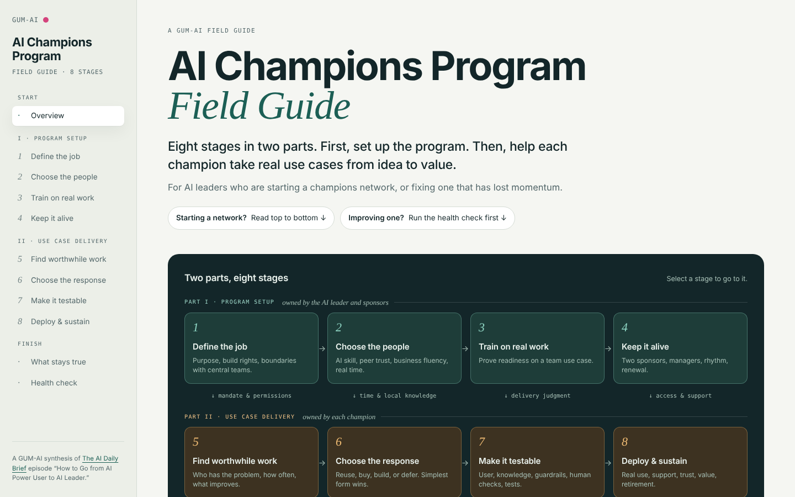

# AI Champions Program Field Guide

**First a framework for setting up a first AI champions program or improving an existing program. Next, a detailed operating rhythm for each champion take real use cases from idea to value. Last, a prompt you can use with AI to guide you on your AI champion journey according to these principals.**

**View the guide:** [sth3000.github.io/aichampionsfieldguide](https://sth3000.github.io/aichampionsfieldguide/)

## What is in this repo

| File | What it is | How to use it |
|---|---|---|
| [`index.html`](index.html) | The field guide. A single self-contained page with the 8-stage map, role spectrum, charter questions, build-decision ladder, and an interactive health check. | View it on the live page, or download it and open it in any browser. |
| [`coach-prompt.md`](coach-prompt.md) | A coaching prompt. It interviews you about your program and produces a **program charter** and a **one-page visual summary**. | Copy everything below the line into Claude, ChatGPT, Gemini, or Copilot. The principles are built in, so no upload is needed. |

**Download the guide:** open [`index.html`](index.html) and select **Download raw file**, or use **Code → Download ZIP** for everything.

## The eight stages

**Part I · Program setup** (owned by the AI leader and sponsors)

1. **Define the job.** Purpose, role position, build rights, boundaries with central teams.
2. **Choose the people.** AI skill, peer trust, business fluency, and protected time.
3. **Train on real work.** Prove readiness on a real team use case.
4. **Keep it alive.** Two sponsors, managers, a steady rhythm, and renewal.

**Part II · Use case delivery** (owned by each champion)

5. **Find worthwhile work.** Who has the problem, how often, and what improves.
6. **Choose the response.** Reuse, buy, build, or defer. Pick the simplest form that works.
7. **Make it testable.** User, knowledge, guardrails, human checks, test cases.
8. **Deploy & sustain.** Real use, support, trust, value, and retirement.

## Source and attribution

The guide is a GUM-AI synthesis of the episode [How to Go from AI Power User to AI Leader](https://www.youtube.com/watch?v=wdXF-5nn-T4) from The AI Daily Brief (October 2026). The ideas are paraphrased. The shared-tool rung in stage 6, the evidence chain, the health check, and the coach prompt are GUM-AI additions.

Make your own decisions on authority, capacity, controls, measures, and support. This guide does not replace them.

---

Made by [GUM-AI](https://gum-ai.com).
